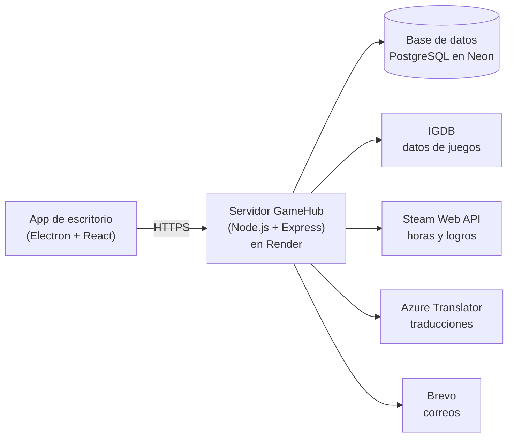

# GameHub

**Tu biblioteca personal de videojuegos.** Busca cualquier juego, guarda lo que juegas, lo que
has terminado y lo que tienes pendiente, ponle nota y reseña, y vincula tu cuenta de Steam
para traer tus juegos, tus horas y tus logros.

**[⬇ Descargar para Windows](https://github.com/jesuusgallego/GameHub/releases/latest)** ·
[Novedades de cada versión](CHANGELOG.md) · [Guía de desarrollo](docs/DESARROLLO.md)

## Qué puedes hacer

- **Buscar juegos** en la base de datos de [IGDB](https://www.igdb.com) y guardarlos en tu
  biblioteca.
- **Organizarlos:** estado (jugando, completado, abandonado, pendiente), tu nota del 1 al 10,
  una reseña y la plataforma en la que lo juegas.
- **Ver la ficha completa** de cada juego: portada, descripción en español, géneros,
  desarrolladora, fecha de lanzamiento, nota de IGDB y capturas.
- **Encontrar lo que buscas** en tu biblioteca: busca por nombre, compañía, género o
  plataforma, filtra por varios criterios a la vez y ordena por fecha, nombre, horas jugadas,
  logros, tu nota o la de IGDB.
- **Vincular Steam:** importa todos tus juegos, con las horas jugadas, la barra de progreso de
  logros y la lista de logros de cada juego. Se mantiene al día sola.
- **Tu perfil:** foto (subida o una ilustración de uno de tus juegos), descripción y
  estadísticas de tu biblioteca.
- **A tu manera:** interfaz en español e inglés y tema claro u oscuro.
- **Cuenta segura:** si olvidas la contraseña, te enviamos un código por correo.

## Instalación (Windows)

1. Entra en la [última versión](https://github.com/jesuusgallego/GameHub/releases/latest) y
   descarga **GameHub-Setup-x.y.z.exe** (en *Assets*).
2. Ejecútalo. Windows mostrará *"Windows protegió su PC"* porque el instalador no está firmado
   (un certificado de firma cuesta dinero): pulsa **Más información → Ejecutar de todos modos**.
3. Abre GameHub y **crea tu cuenta**.

**Se actualiza sola.** Cuando haya una versión nueva, la app la descarga en segundo plano y te
pregunta si quieres reiniciar para instalarla; si dices *Más tarde*, se instala al cerrarla.

> **La primera petición puede tardar hasta un minuto.** El servidor que usa GameHub es
> gratuito y se "duerme" tras un rato sin uso. La app te lo avisa en pantalla; después va con
> normalidad. Necesitas conexión a internet.

## Cómo se usa

1. **Crea una cuenta** con un nombre de usuario, tu email y una contraseña (8 caracteres o
   más, con mayúscula, minúscula y número). El nombre de usuario es único y va siempre en
   minúsculas: de 3 a 20 caracteres, con letras, números y guion bajo (`_`). Después puedes
   iniciar sesión con el email **o** con el nombre de usuario. En *Perfil → Editar perfil*
   puedes añadir, si quieres, tu nombre y apellidos, fecha de nacimiento, sexo, localización, país y
   teléfono.
2. **Busca un juego** en *Buscar* y añádelo a tu biblioteca.
3. **Gestiona tu biblioteca** en *Mi biblioteca*: cambia el estado desde la etiqueta de cada
   tarjeta; con el **clic derecho** sobre una tarjeta puedes editarla o quitarla, y con un clic
   normal se abre la ficha del juego.
4. **Vincula Steam** en *Perfil → Cuentas vinculadas*: pega la URL de tu perfil de Steam (tiene
   que tener los "Detalles del juego" en público). Tus juegos entran como **Pendiente**, porque
   Steam no sabe si te has pasado un juego; el estado lo cambias tú.
5. **Ajusta tu cuenta** en *Perfil*: foto, descripción, email, contraseña o borrar la cuenta.
   El idioma y el tema están en el menú de tres líneas de la esquina.
6. **¿Olvidaste la contraseña?** Pulsa *¿Has olvidado tu contraseña?* en el inicio de sesión,
   escribe tu email, y te llegará un código de 6 dígitos (caduca a los 15 minutos).

## Cómo funciona por dentro

GameHub no es un programa aislado: la app que instalas es solo la parte que ves, y habla por
internet con un servidor propio, que a su vez consulta otros servicios.

### Las tecnologías

| Pieza | Tecnología | Para qué se usa en GameHub |
|-------|------------|----------------------------|
| La interfaz | **React 19** y **React Router** | Pantallas, menús, formularios y la navegación entre ellas |
| Compilación de la interfaz | **Vite** | Empaqueta la interfaz para que cargue rápido |
| La app de escritorio | **Electron** | Mete la interfaz en una ventana de Windows, la actualiza sola y la aísla del sistema por seguridad |
| El servidor | **Node.js** y **Express** | Recibe las peticiones de la app, aplica las reglas (quién eres, qué puedes hacer) y habla con la base de datos y los servicios externos |
| La base de datos | **PostgreSQL** | Guarda usuarios, bibliotecas, cuentas vinculadas y las traducciones ya hechas |
| Alojamiento | **Render** (servidor) y **Neon** (base de datos) | Mantienen GameHub en internet, ambos con plan gratuito |
| Datos de los juegos | **IGDB** (de Twitch) | Nombres, portadas, descripciones, capturas, géneros y notas |
| Tu cuenta de Steam | **Steam Web API** | Tus juegos, horas jugadas y logros |
| Traducción | **Azure AI Translator** | Traduce las descripciones, que IGDB solo da en inglés |
| Correo | **Brevo** | Envía el código para recuperar la contraseña |
| Instalador y versiones | **GitHub Actions** y **GitHub Releases** | Construyen el instalador y lo publican; las apps instaladas buscan ahí las actualizaciones |

### Qué pasa cuando…

- **Inicias sesión.** El servidor comprueba tu contraseña y te entrega una "credencial" (un
  token JWT) que la app guarda y envía en cada petición. Caduca a los 7 días y se invalida
  si cambias la contraseña.
- **Buscas o abres un juego.** La app se lo pide a *tu* servidor, y este a IGDB. Las claves de
  IGDB, Steam y Azure viven solo en el servidor: **nunca van dentro de la app que instalas**.
- **Ves una descripción en español.** El servidor la traduce con Azure y guarda el resultado,
  así que cada texto se traduce una sola vez para todos.
- **Vinculas Steam.** Solo se guarda tu SteamID (un dato público), nunca tu contraseña de
  Steam. El servidor trae tus juegos, horas y logros, y los actualiza solo cada cierto tiempo.
  Al desvincular, tu biblioteca queda exactamente como antes de vincular.
- **Recuperas la contraseña.** El servidor genera un código de 6 dígitos de un solo uso, que
  caduca a los 15 minutos y se anula tras 5 intentos fallidos, y lo envía por correo.
- **Sale una versión nueva.** Al abrir la app, comprueba si hay una Release más reciente en
  GitHub; si la hay, la descarga y la instala.

### Seguridad y privacidad

Lo que guarda GameHub de ti:

- Tu nombre de usuario y tu email.
- Si los rellenas, tu nombre y apellidos, fecha de nacimiento, sexo, localización, país y teléfono.
  Son opcionales y por ahora solo los ves tú. El teléfono no se verifica ni se muestra en ningún sitio.
- Tu contraseña **solo como huella irreversible** (bcrypt): ni siquiera el servidor puede leerla.
- Tu biblioteca: los juegos, su estado, tu nota y tu reseña.
- Opcional: tu foto, tu descripción y tu SteamID.

Lo que **no** guarda: tu contraseña de Steam, ni ningún dato de pago.

Cómo se protege: las contraseñas se guardan con bcrypt; el servidor limita los intentos de
inicio de sesión y de recuperación para frenar los ataques de fuerza bruta; cambiar la
contraseña cierra el resto de sesiones abiertas; y la interfaz de la app corre aislada, sin
acceso al sistema.

## Preguntas frecuentes

**¿Por qué Windows dice "editor desconocido"?** Porque el instalador no está firmado con un
certificado de pago. No indica un problema con el archivo: el instalador lo construye GitHub
Actions a partir del código público de este repositorio.

**¿Por qué a veces tarda tanto en abrir?** El servidor gratuito se duerme tras unos 15 minutos
sin uso y tarda hasta un minuto en despertar. Pasa solo con la primera petición.

**¿Puedo vincular PlayStation, Xbox o Epic?** No: Steam es la única plataforma que ofrece una
API oficial para leer la biblioteca de un jugador.

**¿Por qué mis juegos de Steam entran como "Pendiente"?** Steam no guarda si te has pasado un
juego, y estimarlo daría resultados engañosos. El estado lo eliges tú.

**¿Cómo borro mi cuenta?** *Perfil → Seguridad → Eliminar cuenta*. Se borra todo, incluida tu
biblioteca, y no se puede deshacer.

**¿Funciona sin internet?** No: la biblioteca vive en el servidor.

**¿Y en macOS o Linux?** De momento solo hay instalador para Windows.

## ¿Quieres tocar el código?

Todo lo técnico (cómo montar el entorno, la estructura del proyecto, la API, las pruebas, cómo
publicar una versión) está en la **[guía de desarrollo](docs/DESARROLLO.md)**. Para poner tu
propio servidor en internet, mira [`docs/DESPLIEGUE.md`](docs/DESPLIEGUE.md).

## Licencia y créditos

El código de GameHub se distribuye bajo la licencia **MIT** (ver [`LICENSE`](LICENSE)): puedes
usarlo, modificarlo y compartirlo, conservando el aviso de copyright.

Lo que **no** es del proyecto y mantiene sus propios términos:

- **Datos de los juegos** (nombres, portadas, capturas, descripciones, notas): vienen de
  [IGDB](https://www.igdb.com), propiedad de Twitch, y se usan conforme a los términos de su API.
- **Steam** y su logo son marcas de Valve Corporation. GameHub no está afiliado ni respaldado
  por Valve; el logo solo indica que una cuenta o un juego vienen de Steam. Los datos se
  obtienen de la Steam Web API.
- **Iconos de plataformas** (PlayStation, Xbox, Nintendo, Apple, Android, Linux…): trazados de
  [Simple Icons](https://simpleicons.org) (CC0). Las marcas pertenecen a sus dueños y se usan
  solo para identificar la plataforma.
- **Tipografías** Barlow Condensed y Figtree, bajo la licencia SIL Open Font License, servidas
  con los paquetes `@fontsource`.
- **Traducciones automáticas** de las descripciones: Azure AI Translator (Microsoft) o
  LibreTranslate.
